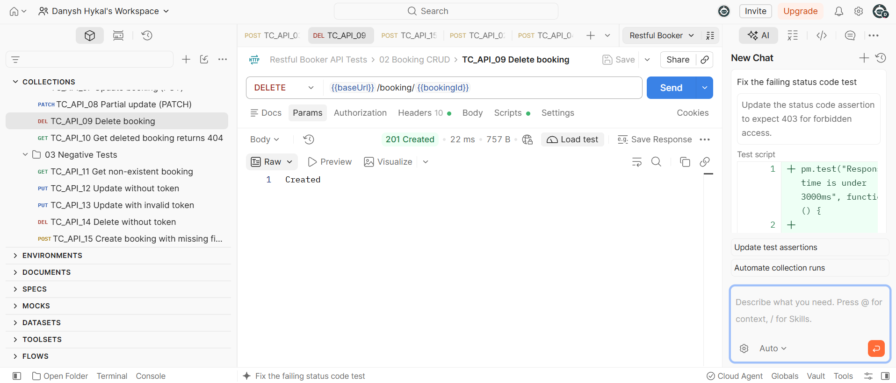
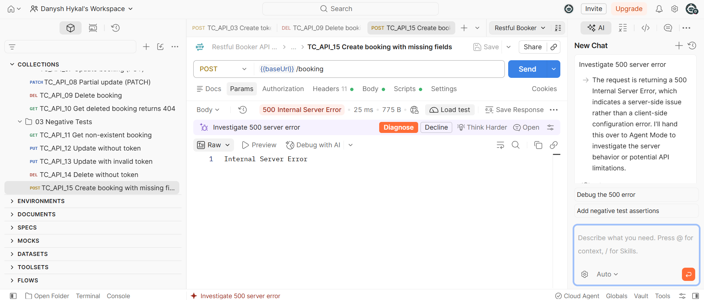

# Bug Reports

## BUG-001: Invalid login returns 200 OK instead of 401 Unauthorized

| Field | Detail |
|---|---|
| **ID** | BUG-001 |
| **Endpoint** | `POST /auth` |
| **Severity** | Medium |
| **Priority** | High |
| **Found by** | TC_API_03 |
| **Environment** | https://restful-booker.herokuapp.com |
| **Status** | Open |

**Steps to reproduce**
1. Send `POST /auth` with header `Content-Type: application/json`
2. Body: `{"username": "admin", "password": "wrong_password"}`

**Expected result**
Status `401 Unauthorized`, with an error message.

**Actual result**
Status `200 OK`, with body `{"reason": "Bad credentials"}`.

**Impact**
Clients that check only the status code will treat a failed login as successful.
This can cause confusing behaviour and makes error handling harder for API consumers.

**Evidence**

---

## BUG-002: DELETE booking returns 201 Created instead of 200 OK / 204 No Content

| Field | Detail |
|---|---|
| **ID** | BUG-002 |
| **Endpoint** | `DELETE /booking/{id}` |
| **Severity** | Low |
| **Priority** | Low |
| **Found by** | TC_API_09 |
| **Environment** | https://restful-booker.herokuapp.com |
| **Status** | Open |

**Pre-conditions**
- A valid token from `POST /auth`
- An existing booking ID from `POST /booking`

**Steps to reproduce**
1. Send `DELETE /booking/{id}`
2. Headers: `Content-Type: application/json`, `Cookie: token={token}`

**Expected result**
Status `200 OK` or `204 No Content`. The booking is deleted.

**Actual result**
Status `201 Created`, with body `Created`. The booking is deleted
(a follow-up `GET /booking/{id}` returns `404`, confirmed by TC_API_10).

**Impact**
The delete works, but the status code is misleading. `201` means a new resource
was created, which is the opposite of deleting. Client code that checks for
`200`/`204` will wrongly treat a successful delete as a failure.

**Evidence**

---

## BUG-003: Creating a booking with missing fields returns 500 Internal Server Error

| Field | Detail |
|---|---|
| **ID** | BUG-003 |
| **Endpoint** | `POST /booking` |
| **Severity** | High |
| **Priority** | Medium |
| **Found by** | TC_API_15 |
| **Environment** | https://restful-booker.herokuapp.com |
| **Status** | Open |

**Steps to reproduce**
1. Send `POST /booking` with header `Content-Type: application/json`
2. Body: `{"firstname": "OnlyFirstName"}` (missing `lastname`, `totalprice`,
   `depositpaid` and `bookingdates`)

**Expected result**
Status `400 Bad Request`, with a message listing the missing fields.

**Actual result**
Status `500 Internal Server Error`, with body `Internal Server Error`.
No validation message is returned.

**Impact**
The server crashes on bad input instead of validating it. Users get no clue
about what is wrong with their request. Unhandled 500 errors can also expose
server instability, and repeated bad requests could affect availability.

**Evidence**
