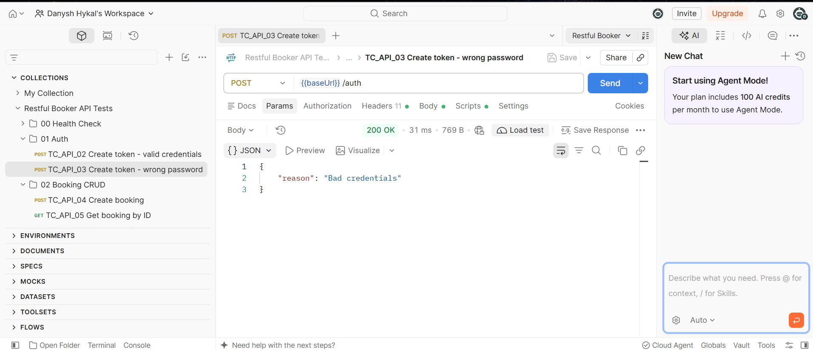

# Bug Reports

## BUG-001: Invalid login returns 200 OK instead of 401 Unauthorized

| Field | Detail |
|---|---|
| **ID** | BUG-001 |
| **Endpoint** | `POST /auth` |
| **Severity** | Medium |
| **Priority** | High |
| **Found by** | TC_API_03 |
| **Environment** | https://restful-booker.herokuapp.com |
| **Status** | Open |

**Steps to reproduce**
1. Send `POST /auth` with header `Content-Type: application/json`
2. Body: `{"username": "admin", "password": "wrong_password"}`

**Expected result**
Status `401 Unauthorized`, with an error message.

**Actual result**
Status `200 OK`, with body `{"reason": "Bad credentials"}`.

**Impact**
Clients that check only the status code will treat a failed login as successful.
This can cause confusing behaviour and makes error handling harder for API consumers.

**Evidence**
